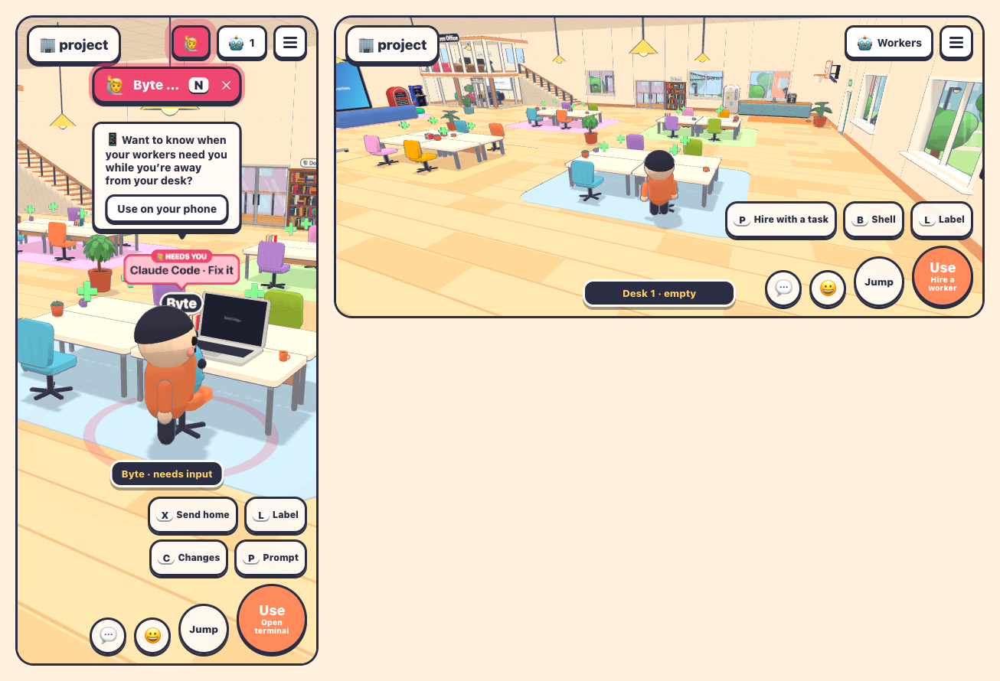

# Controls

Back to the [README](../README.md).

| Key | Action |
| --- | --- |
| W A S D / arrows | Walk (hold Shift to run); in a car, W is the gas, S brakes and reverses, A and D steer |
| Space | Jump (you can land on desks, couches and the cars in the garage); in a car, brake |
| Mouse drag / wheel | Orbit / zoom the camera |
| E | Interact: hire a worker, open its terminal, read a board, take an issue's note off the board, prompt a board agent, call a meeting in the meeting room, draw on the whiteboard, read the docs at the bookshelf, watch the TV, sit down (or get up), ride the elevator, grab a coffee, take a smoke break, tee off at the golf tee, pet the dog, pick up the basketball (then hold E and let go to shoot), play the arcade cabinet in the lounge, or watch whoever's playing it (each game's keys are in [The arcade](arcade.md)), play retro games on the boss's computer from the boss's chair (its keys are in [The boss's computer](retro.md)), order a drink at the rooftop bar, blow the DJ's air horn, step up to the dart board or the axe lane on the roof (then hold Space and let go to throw), get into one of the cars in the garage (behind the wheel, or beside whoever's driving) or out of it, knock through the north wall past the gong for 2 more desks (at the **🚧 Room to grow** sign). In the [castle](maps.md#the-castle): sit on the throne, where E is for whoever's first in line (or the Hand of the King, with nobody waiting), and speak to the Hand to send out a new worker. On the [space station](maps.md#the-space-station) it's the captain's chair and the First Officer |
| K | On the castle's throne (or in the station's captain's chair): speak to the Hand of the King (the First Officer), to send out a new worker |
| P | Prompt: give a task to a new worker, or to the one at this desk |
| C | Changes: the files the worker at this desk changed and their diff; commit, discard or open a PR |
| B | Open a shared shell at an empty desk |
| R | Resume a sleeping worker (or restart a shell) |
| X | Send a worker home (frees the desk; a worker with its own worktree asks what to do with it). In the [castle](maps.md#the-castle), the Kingsguard takes it down to the dungeon; on the [space station](maps.md#the-space-station), Security puts it out of the airlock |
| L | Hang a big sign over the desk you face (*Operations*, *Code cleanup*), in one of seven colors; again to change it or take it down |
| O | Open a pull request for a worker on its own branch, or see the one it has (a worker across several projects gets one in each) |
| N | Go to the worker that has waited longest on someone; again for the next one |
| F | Hang a picture from the web on a wall (scroll to size it, click to hang it) |
| Q | Put back the issue card you're carrying, or drop the basketball |
| H | These controls; in a car, honk the horn |
| T / Enter | Chat |
| G / 1–6 | Emote: hold G for the wheel (point and let go) or press 1–6 to wave, give a thumbs up, clap, dance, point or facepalm; everyone on your floor sees it |
| / | Search the chat and every terminal on your floor |
| Ctrl + K (⌘K on a Mac) | Command palette: find a worker, issue, PR, service, board, teammate or action; Enter opens it, Shift+Enter walks you there first |
| V | Join voice; in voice, hold to talk (you're muted when you let go) |
| M | Mute / unmute in voice |
| Ctrl + Space | Dictate, in a worker's terminal or a prompt box: hold it and talk, and what you said is typed in when you let go. A quick tap leaves it listening until the next tap. The **🎤** does the same |
| Tab | The ☰ menu: every window, and what shows on screen |
| Esc | Close any window and get back to looking around. In a terminal, **Hide**, **✕** and Esc only hide the terminal; the worker keeps running |
| Ctrl + [ | Send Esc to a terminal instead, to close a menu like Claude's `/skills` or interrupt Claude. **⎋ Esc** in the terminal's header does the same |

You can also click a nearby desk to interact with it, or click a worker in the Workers panel (**🤖 Workers**, top right) to open its terminal.

A phone opens the 2D view at `/lite`, made for it: a terminal there has a row of keys under it (**1** **2** **3**, the arrows, Enter, Tab, Esc, Ctrl+C) and a box to send a prompt. See [Features](features.md). To walk around the 3D office on a phone instead, tap **🏢 3D** there and play it with your thumbs (next).

## On a touch screen

On a phone or a tablet with no mouse, the 3D office has touch controls. **⚙️ Settings → You → Touch controls** turns them **On** for a touchscreen laptop, or **Off** for a tablet with a keyboard and mouse of its own (**Auto**, the default, puts them up on a touch screen with no mouse). The first time they're up, a card shows what each thumb does.

| Touch | Stands for |
| --- | --- |
| Left thumb, anywhere on the left 40% of the screen: a stick appears under it, and you walk the way you slide it, faster the further you go | W A S D (it's analog: a little walks slowly, any angle works); in a car, gas, brake and reverse, and steering; at the tee, the oche or the axe line, aiming |
| Slide it all the way out (the knob turns orange) | Shift: run |
| Drag on the right (or anywhere a thumb isn't walking) | The mouse: look around, or orbit the camera in third person. **⚙️ Settings → You → Look speed** makes it faster or slower |
| Pinch | The mouse wheel: zoom the camera in third person |
| A quick tap on the scene | A click: use what's in the middle of the screen (in third person, what you tapped) |
| **Use**, the big button bottom right, saying what it'll do (*Hire a worker*, *Open terminal*, *Floors & projects*, *Get out*); grey with nothing in reach | E. Hold it to hold E: wind up a shot with the basketball and let go to shoot |
| **Jump**, beside it, which takes the name of whatever Space does where you are (*Brake* in a car, *Swing* at the tee, *Throw* at the oche) | Space. Hold it for a swing or a throw and let go, as with the key |
| The buttons above Use, only the ones that do something here: at a desk **P** Prompt, **C** Changes, **R** Resume, **X** Send home, **O** PR, **L** Sign, **B** Shell; **Q** with an issue card or the ball in your hands; **H** Honk in a car; **K** the Hand of the King on the throne; **Esc** Cancel while hanging a picture | Those keys |
| **😀** | G: the emote wheel; tap an emote on it |
| **💬** | T: the chat, with the phone's keyboard |
| The waiting workers' button on the top bar (*🙋 2 waiting*) | N |
| **☰**, top right | Tab: every window, and **🗂️ 2D view** to go back to the 2D view |

The hint bar sits above the buttons and leaves out the keys that have one; *🕹️ Stick* in it means the left thumb. Windows open full screen on a phone, a worker's terminal with the keypad the 2D view's has, and closing one (its **✕**) hands the thumbs straight back: there's no mouse to capture, so nothing asks you to tap first.

## In a terminal

The prompt edits the way it does in your own terminal (iTerm2's *Natural Text Editing*, or VS Code's), in Claude Code, Codex, OpenCode and a shell alike:

| Key | Action |
| --- | --- |
| Shift + Enter | A new line in an agent's prompt, without sending it (in a shell it runs the line, like Enter) |
| Ctrl + Space | Dictate: hold it and talk, and what you said is typed in at the cursor when you let go (see [Features](features.md)). **🎤 Dictate** in the terminal's header does the same |
| Ctrl + ⌫ / ⌥ + ⌫ | Delete the word before the cursor |
| ⌘ + ⌫ | Delete to the start of the line (Mac) |
| ⌘ + ⌦ | Delete to the end of the line (Mac) |
| ⌘ + ← / → | Jump to the start / end of the line (Mac) |
