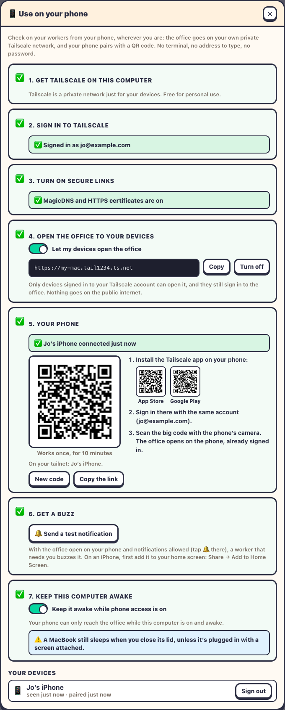
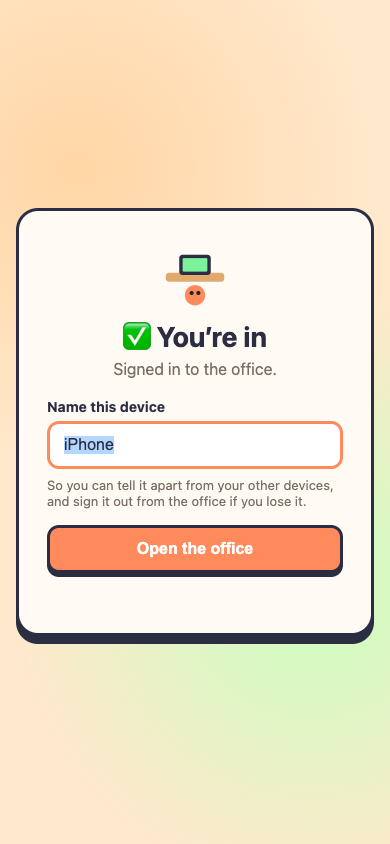
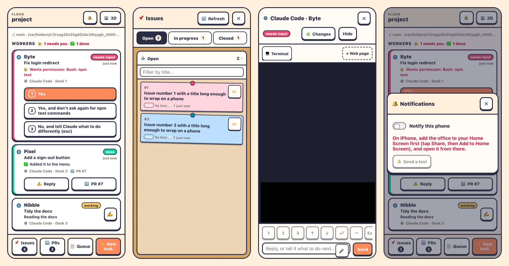

# Your office on your phone

Running the office on your own computer and want to check on it from your phone when you're away from your desk? Back to the [README](../README.md).

The office listens on `127.0.0.1` only, so nothing but your computer can open it. The way to reach it from your phone, wherever you are, is [Tailscale](https://tailscale.com): a private network of your own devices, free for personal use. Tailscale Serve puts the office on an `https://` address only your devices can open, with a real certificate, and you don't open any ports or change how the office listens. The office sets all of this up for you, from one window.

## ☰ → 📱 Use on your phone

Open **☰ → 📱 Use on your phone** (also **⚙️ Settings → 📱 Phone**, and offered once the first time you hire a worker). It's a list of numbered steps, and each one shows ✅, ⏳ or ❗ from what the office sees of Tailscale every few seconds, so you never have to work out what state things are in. Follow the buttons:



1. **Get Tailscale on this computer.** **Download Tailscale** opens the right download for your computer (on a Mac with Homebrew, `brew install --cask tailscale` works too). Install it and open it: the step turns ✅ by itself. If it's installed but not running, the step says how to start it.
2. **Sign in to Tailscale.** **Sign in** opens Tailscale's sign-in page. Use the account you'll sign in with on your phone too. The step then shows who it's signed in as.
3. **Turn on secure links.** Your tailnet needs MagicDNS and HTTPS certificates on. **Turn on** opens the page in Tailscale's admin console that does it (once step 4 has asked Tailscale for it, the exact link Tailscale hands back).
4. **Open the office to your devices.** Flip **Let my devices open the office**. The office runs Tailscale Serve for itself and shows its address, `https://<your-computer>.<your-tailnet>.ts.net`, with **Copy** and **Turn off**. If another app already serves `https://<your-computer>…/` through Tailscale, the office leaves it alone and takes port 8443 (or 10000) instead, and says so.
5. **Your phone.** Install the Tailscale app on your phone (the App Store and Google Play each have their own small QR code there), sign in with the same account, then scan the big QR code with the phone's camera. It opens the 2D view on your phone, already signed in, and asks what to call the phone. The step turns ✅ when the phone first connects.
6. **Get a buzz.** On the phone, add the office to your home screen when it offers (**📲 Add to home screen** on Android; on an iPhone a card shows where **Share → Add to Home Screen** is), open it from its new icon, tap **🔔** and turn on **Notify this phone**. From then on the phone buzzes when a worker needs you, even with the office closed and the phone locked. **Send a test notification** here buzzes every phone of yours that has it on (and any with the office open).
7. **Keep this computer awake.** On by default once phone access is on: your phone can only reach the office while this computer is on and awake. On a Mac it holds `caffeinate`, on Linux `systemd-inhibit`, and on Windows the system's own keep-awake, for as long as the office runs. A laptop still sleeps when you close its lid, and the window warns you when it can tell.



Only admins turn phone access on and off, and keep-awake. Anyone else signed in to the office sees steps 5 and 6 once an admin has turned access on, to pair their own phone (before that, *Ask an admin to turn on phone access*).

Phone access stays on through restarts: when the office starts, it checks Serve still points at it and puts it back if it doesn't. While it's on, the top bar shows **📱 On**.

### Your devices

Every phone you paired is listed in the 📱 window and in **🔐 Your sign-ins**, with when it was last seen. **Sign out** ends its session at once (good for a lost phone). Admins see everyone's in **🔑 Accounts**. A pairing QR code works once, for ten minutes, and signs the phone in as whoever made it (or with the shared office password, when you came in with that). A paired phone stays signed in for 90 days, or until it's signed out. The office opened from a phone's home screen is listed here too (*iPhone (home screen)*), once it's first opened there: its session starts over every time it's used, so a phone you use the office on never asks for the password again until you sign it out.

### Notifications on your phone

**🔔** at the top of the 2D view opens one switch, **Notify this phone**, and **Send a test**. With it on, the office sends the phone a web push when a worker has needed input, or been done, for a few seconds with nobody at its terminal (the same rule as the team webhook), so it buzzes with the office closed and the screen locked: *🙋 Byte needs you: Wants permission: Bash: npm test*. Tapping it opens the 2D view on that worker's terminal. On Android, a worker asking for permission gets its first and last choices as buttons on the notification (*Yes*, *No…*), which answer it there and then. A phone that has the 2D view on screen isn't pushed, and its notifications go away once someone has dealt with the worker.

When it can't work, the window says why: *On iPhone, add the office to your Home Screen first* (iOS only lets a page on the home screen notify), or that notifications are blocked for the office in the phone's settings. Every device of yours that gets notifications is listed there and in **🔐 Your sign-ins**, each with a 🗑.

There's nothing to set up for it. The office makes its own VAPID key pair the first time, and keeps it and the devices in `.agent-office/push.json` in its data folder. A push goes through the phone's own push service (Apple's, Google's or Mozilla's, which is how web push works), encrypted so only the phone can read it; the office sends to those services and nowhere else.

### The office as an app



On a phone, the office's own address goes straight to the 2D view, before the 3D office starts to load (**🏢 3D** there, or `/?3d=1`, still opens the 3D office, and that browser stays in 3D after that). Added to the home screen, it opens full screen with its own icon. While the office can't be reached (the computer asleep, Tailscale off), it shows *Reconnecting…* and keeps trying, instead of a browser error. Coming back to it after a while, it reconnects at once and says *Updating…* until the floor is current; pulling the list down does the same.

### What it does and doesn't do

- **Nothing goes on the public internet.** Only devices signed in to your Tailscale account can open the address, and they still meet the office's own sign-in. The office never uses Funnel.
- **It never changes what isn't its own.** It reads Serve's settings first, never overwrites another app's handler, and **Turn off** removes exactly what it added, so your phone can't reach the office any more.
- **The workers' web servers come too.** While it's on, each worker's server is on your tailnet at `https://<your-computer>….ts.net:<port>`, so the **🌐 Services** board's links work from your phone, behind the office's sign-in.
- **The office believes Serve.** Tailscale Serve is a proxy on the same computer. While the office serves through it, it believes the `X-Forwarded-*` headers that come from this computer (so your phone's cookie is a secure one, and a wrong password on the phone doesn't count against the computer's own browser), and ignores them from anywhere else. You don't need `--trust-proxy`.
- **On Linux,** changing Serve's settings needs root unless your user is Tailscale's operator. The window shows the one command to run when that's what's in the way: `sudo tailscale set --operator=$USER`.

## From a terminal

`agent-office phone` does the same from a terminal, for a headless machine or if you'd rather. It works whether the office is running or not; a running office picks up what it did within a minute.

```bash
agent-office phone          # where each step is
agent-office phone on       # put the office on your tailnet
agent-office phone pair     # a QR code in the terminal that signs your phone in, once
agent-office phone off      # take it off again
```

`pair --as <name>` signs the phone in as that account rather than with the shared password. `--dir` and `--port` say which office, as for `agent-office accounts`. See `agent-office phone --help`.

## On a server

On an office set up with [`deploy/provision.sh --tailscale`](self-hosting.md) (or `deploy/aws.sh up --tailscale`), the office is already on your tailnet. The 📱 window says so and goes straight to the QR code for your phone.

## By hand

If you'd rather do it yourself, this is what the window does:

1. **Install Tailscale on both.** On the computer that runs the office, [install Tailscale](https://tailscale.com/download) and sign in. On your phone, install the Tailscale app from the App Store or Google Play and sign in with the same account.
2. **Turn on HTTPS.** On Tailscale's [DNS](https://login.tailscale.com/admin/dns) page, turn on **MagicDNS** and **HTTPS Certificates**.
3. **Serve the office on your tailnet**, with the office's port (4600 unless you started it with `--port`):

   ```bash
   tailscale serve --bg 4600
   ```

   With the Mac App Store version of Tailscale, the `tailscale` command isn't on your PATH until you install it from the app's settings (or run `/Applications/Tailscale.app/Contents/MacOS/Tailscale serve --bg 4600`).
4. **Start the office with `--trust-proxy`**, so it believes Serve's headers (the window doesn't need this, since it knows it set Serve up):

   ```bash
   agent-office --trust-proxy
   ```

5. On your phone, with Tailscale connected, open `https://<your-computer>.<your-tailnet>.ts.net/lite` and sign in with the office password or your own [account](../README.md#add-users). Add it to your home screen, open it from there, and turn on **🔔 Notify this phone**.

`tailscale serve reset` stops serving everything on your tailnet (the window's **Turn off** removes only the office's). To keep a Mac awake by hand, `caffeinate -s` while it's plugged in, or **System Settings → Battery → Options → Prevent automatic sleeping on power adapter when the display is off**.

## On your phone

From there you have the whole floor: every worker with what it's asking or doing, ones waiting on you first. One asking for permission or to pick an option shows its choices as buttons (**1 Yes**, **2 Yes, and don't ask again…**, **3 No…**), answered right there; one that's done has **✍️ Reply** and its **🔀 PR**. Tap a card for its terminal, with **1** **2** **3** for a permission prompt, the arrows, Enter, Esc and Ctrl+C, **A−** **A+** for the text size, one finger to scroll back, and a long press on a line to copy it; **✍️** sends a worker a prompt without opening its terminal; **📌 Issues**, **🔀 PRs**, **📋 Queue** and **✨ New task** to hand out work; and the floor switcher at the top for your other projects. Everything the 2D view does is in [Features](features.md) (*The 2D view, for your phone*). The windows fit a phone: the boards show one column at a time, picked from tabs along the top; in a prompt box Return makes a new line and **Send** sends; and the windows and the terminal's keys stay above the on-screen keyboard. The full 3D office opens at `/?3d=1`, but it's heavy for a phone.

If you want the office there whether or not your computer is on, run it on a server instead: [`deploy/provision.sh --tailscale`](self-hosting.md) does all of the above for you, on any Ubuntu or Debian machine.

## Why not something else

- **`--host 0.0.0.0`** lets other devices on your Wi-Fi in, over plain http, so it only works at home, and anyone else on that network can try the password.
- **A public tunnel** (Tailscale Funnel, Cloudflare Tunnel, ngrok) puts the office on the internet, and whoever signs in can run commands on your computer through its workers. Keep it on your tailnet, where only your own devices can reach it.
- **Remote desktop** to the computer works, but the 3D office on a phone screen through it is hard to use. The 2D view is made for this.
